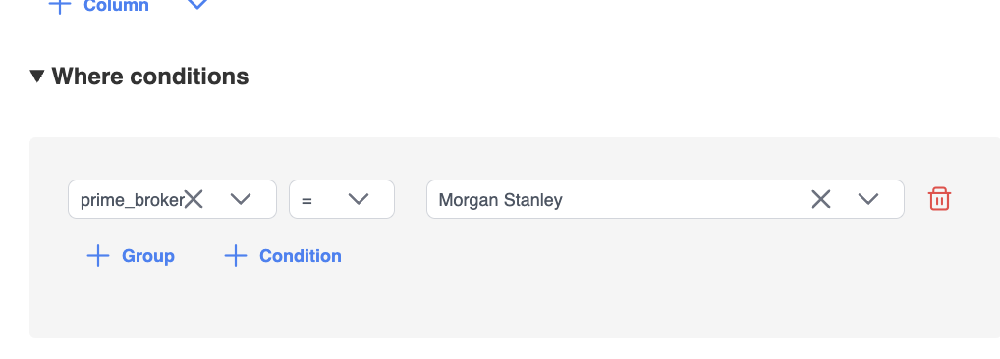
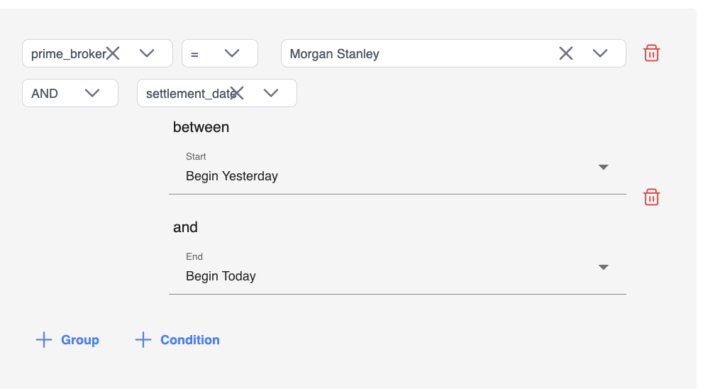

# Where clauses

**Where conditions** filter which rows appear in the view. Build a tree of conditions and groups with AND/OR logic.

## Open Where conditions

1. Scroll to **Where conditions** in the view form.
2. The root group is already present — add conditions or nested groups inside it.

## Add a condition

1. Choose **Condition**.
2. Pick the **left** value (usually a column from a selected table).
3. Choose an **operator**.
4. Set the **right** value (another column or a custom value), unless the operator is a null check.

## Operators

Available operators depend on the data type of the left side.

### Numbers and booleans

Typical comparison operators:

- `=`
- `<>`
- `>`
- `>=`
- `<`
- `<=`
- `is null`
- `is not null`

### Text

- `=`
- `contains`
- `does not contain`
- `is null`
- `is not null`

### Dates

Date conditions use a **between** range:

- **Start** — inclusive start
- **End** — inclusive end

Start and End take a date or a preset. Presets include **Beginning of day**, **End of day**, **Begin Today**, and **Begin Yesterday**.

A trade-date window is `TradeDate` between **Beginning of day** and **End of day**. Timestamps later that same day stay inside the view. The same presets are valid on a Table to CSV filter.

## Groups and AND / OR

1. Choose **Group** to nest a set of conditions.
2. Set the group’s **logical operator** to **AND** or **OR**.
3. Nest groups when you need mixed logic (for example, `(A AND B) OR C`).

## Left and right values

Both sides of a condition can be:

- A **column** from the base table or a joined table
- A **custom value** (text, number, boolean, or date, depending on type)

This lets you compare column-to-column (for example, `Amount > Threshold`) or column-to-literal (for example, `Status = 'Active'`).

## Tips

- Filters apply after joins — think in terms of the combined row set.
- Prefer filtering on indexed / key columns when performance matters.
- Remove unused conditions before saving to keep the view easy to maintain.
- For calculated or conditional output columns (not row filters), see [Column types](./column-types).
