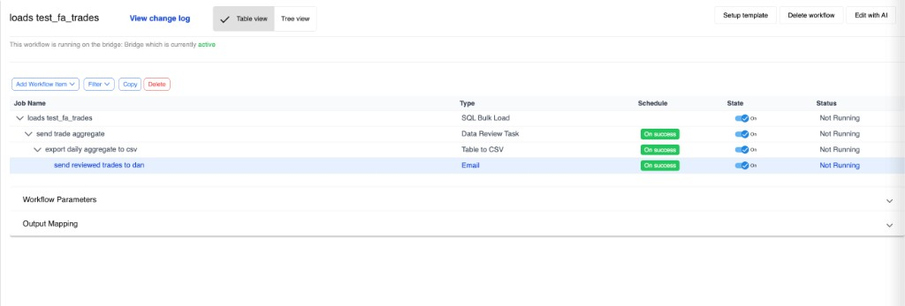
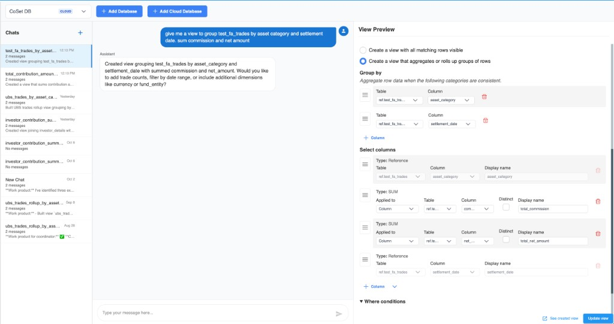
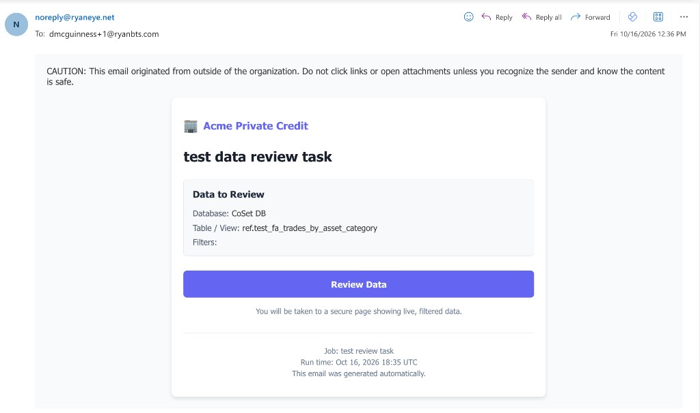
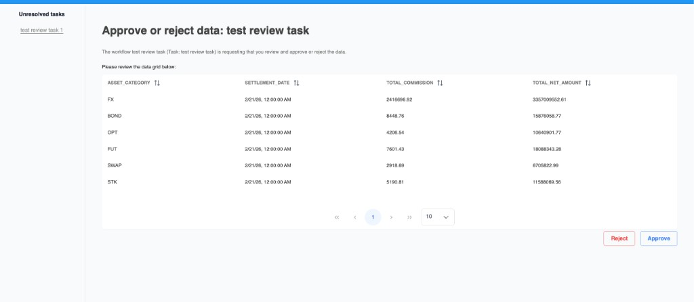

# Load, review, and send

<video controls playsInline preload="metadata" width="720" src="../../../examples/e2e-view-workflow.mp4">
  A browser that plays MP4 can play this recording.
</video>

[Download the recording](../../../examples/e2e-view-workflow.mp4) (MP4).

**Goal:** Load a trades file into a warehouse table, roll it up in a view, send that aggregate for approval, then export the approved result to CSV and email it.

The recording is the workflow **loads test_fa_trades**. The table is `test_fa_trades`. The view groups by asset category and settlement date and sums commission and net amount.

## Tree

The root job is the load. Each later step runs **On success** of the one above it, so the CSV and the email run only after the review is approved.

```
loads test_fa_trades                         SQL Bulk Load
 └── send trade aggregate                    Data Review Task    [On success]
      └── export daily aggregate to csv      Table to CSV        [On success]
           └── send reviewed trades to dan   Email               [On success]
```



## 1. Load the file

Job type: [SQL Bulk Load](../job-types/sql-bulk-load)

**loads test_fa_trades** reads the source file and loads it into `test_fa_trades`. Later jobs use that table only through the view, not as the file that gets emailed.

## 2. Aggregate the trades

Build the view on the warehouse **Views** tab with [Create View using AI](/views/ai-views), after the table exists.

Prompt used in the recording:

```text
give me a view to group test_fa_trades by asset category and settlement date. sum commission and net amount
```

The draft is an aggregate view (one row per group, not one row per trade):

| Setting | Value |
| --- | --- |
| **I want to** | Aggregates / roll up groups of rows |
| **Group by** | `asset_category`, `settlement_date` |
| **Select** | `asset_category`, **SUM** `commission` → `total_commission`, **SUM** `net_amount` → `total_net_amount`, `settlement_date` |



Save the view before you point the review and the export at it. Manual equivalent: [Group by & aggregates](/views/group-by).

## 3. Review, then export and email

| Job | Type | Runs when |
| --- | --- | --- |
| **send trade aggregate** | [Data Review Task](../job-types/data-review-task) | Load succeeds. Reviewer approves or rejects the aggregate. |
| **export daily aggregate to csv** | [Table to CSV](../job-types/table-to-csv) | Review is approved. Source is `View: ref.test_fa_trades_by_asset_category`, not `test_fa_trades`. |
| **send reviewed trades to dan** | [Email](../job-types/email) | Export succeeds. Attach the CSV with [output mapping](../parameters) from Table to CSV `CalculatedOutputFolder` / `CalculatedOutputFile`. |

The review email names the warehouse and the view (`CoSet DB` / `ref.test_fa_trades_by_asset_category`) and links to the live rows. Filters is empty.



Opening that link shows one row per asset category and settlement date, with the same columns as the view, and **Reject** and **Approve**.



**Approve** makes the review succeed, so the export and the email run. **Reject** makes the review fail, so those children do not run.

## What you practiced

- [SQL Bulk Load](../job-types/sql-bulk-load) of a file into a warehouse table
- An aggregate [view](/views/group-by) drafted in [Create with AI](/views/ai-views)
- [Data Review Task](../job-types/data-review-task) as the gate before distribution
- [Table to CSV](../job-types/table-to-csv) of that view, then [Email](../job-types/email)
